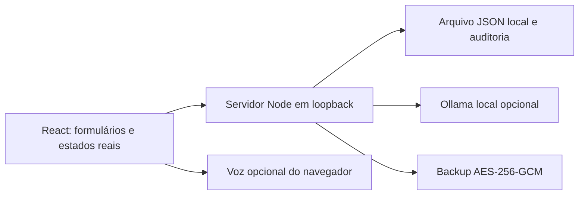
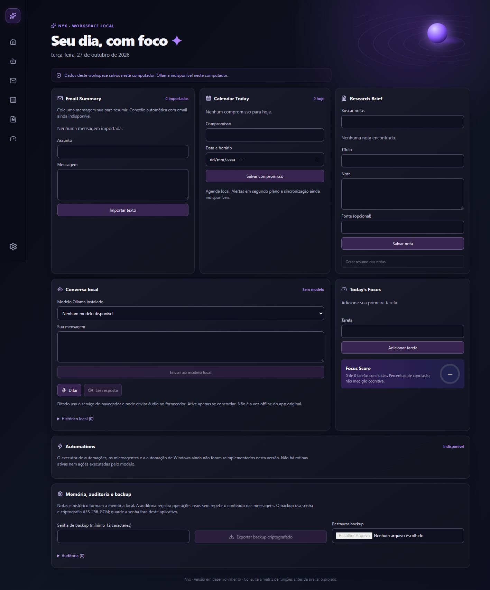

# Nyx · Workspace local

> 🚧 Projeto em desenvolvimento aberto. Esta é uma versão inicial funcional para execução local; melhorias e novos módulos serão adicionados gradualmente. Veja o [roadmap](ROADMAP.md) e a [matriz de funções](docs/FEATURES.md).


Workspace com interface navy e roxa, esfera neutra, tarefas, agenda, notas, histórico e backup criptografado. Inicia vazio e usa somente informações inseridas por quem o executa. Não contém emails, compromissos ou métricas inventadas.

**Esta versão ainda não reúne todas as capacidades planejadas.** A [matriz de funções](docs/FEATURES.md) identifica o que está implementado, parcial ou pendente, incluindo recursos inspirados no aplicativo desktop de referência.

## Executar

Requisito: Node.js 24. Instale as dependências, gere a interface e inicie o serviço:

```sh
npm ci
npm run build
npm start
```

Abra o endereço mostrado no terminal: `http://127.0.0.1:4310`. O serviço aceita apenas conexões locais, valida Host e Origin e exige um token por sessão para alterações. Não hospede este servidor na internet: não existe autenticação multiusuário.

`npm run dev` abre somente o frontend para desenvolvimento. Use o fluxo de build e start acima para testar a aplicação completa.

## IA local

Conversa, resumos de mensagens e síntese de notas usam uma instância do [Ollama](https://ollama.com/) no próprio computador, em `127.0.0.1:11434`. Instale o Ollama e um modelo compatível com seus recursos. O projeto consulta os modelos instalados; não baixa modelos e não escolhe um fornecedor externo silenciosamente.

As chamadas usam os endpoints oficiais [List models](https://docs.ollama.com/api/tags) e [Chat](https://docs.ollama.com/api/chat). Uma requisição pode executar por vez, com prazo de 120 segundos. Falhas aparecem na interface; não são substituídas por respostas de demonstração. A conversa inclui os últimos três pares de mensagens, com limite de texto. A síntese de pesquisa recebe no máximo os primeiros 20 mil caracteres das notas.

Sem Ollama, tarefas, notas, agenda e backup continuam disponíveis. A integração foi implementada, mas a geração real ainda não foi validada neste ambiente porque o serviço não estava acessível.

## Funções disponíveis

| Função | Comportamento real |
| --- | --- |
| Tarefas e Focus Score | Criar, concluir, excluir e persistir; score = concluídas / total × 100; vazio exibe `—` |
| Agenda local | Criar, listar por horário e excluir compromissos; contagem considera a data local |
| Mensagens | Importar texto manualmente; resumo depende do modelo local; não conecta Gmail ou Outlook |
| Notas | Criar, buscar no texto, registrar fonte informada e excluir; fonte não é verificada automaticamente |
| Histórico | Salvar conversas geradas pelo modelo; limite dos últimos 100 registros |
| Auditoria | Registrar criação, alteração, exclusão e geração; limite de 1.000 entradas; não repete conteúdo |
| Backup | Exportar AES-256-GCM com chave derivada por scrypt; restaurar mediante senha e confirmação |
| Voz do navegador | Ditado e leitura por APIs nativas quando disponíveis; exige validação manual |

O ditado do navegador pode transmitir áudio ao serviço do fornecedor. Ele é acionado explicitamente pelo usuário e **não equivale** ao reconhecimento offline do aplicativo desktop. Este projeto não implementa faster-whisper, Kokoro ou SAPI5.

## Arquitetura



```text
src/                 Interface React e estilos responsivos
server/              API local, persistência, criptografia e testes
docs/FEATURES.md     Matriz de funções e limites
.nyx-data/           Criado em execução; ignorado pelo Git
```

## Dados e privacidade

Os registros ficam em `.nyx-data/workspace.json`, em texto simples no disco. O backup exportado é criptografado; o armazenamento de trabalho não é. Use as permissões e a criptografia de disco do seu sistema se necessário. Não acrescente dados locais, conversas, backups ou credenciais ao controle de versão.

O backup inclui tarefas, eventos, notas, mensagens e conversas. A restauração substitui o workspace, gera novos identificadores e inicia uma nova trilha de auditoria. Registros antigos de auditoria não são restaurados. Guarde um backup atual antes de substituir seus dados. A senha não é armazenada; sua perda impede a recuperação.

O código foi escrito para esta versão pública, com consulta apenas ao inventário geral de funcionalidades do projeto de referência. Nenhum arquivo de código, configuração, personagem, histórico ou banco privado foi importado.

## Verificar

```sh
npm run lint
npm run build
npm test
```

Os testes exercitam persistência, validação de campos, criptografia, senha incorreta, adulteração, proteção contra origem externa, proteção de alterações e reinício do serviço HTTP. Os valores usados nos testes são entradas técnicas temporárias, não dados pré-carregados no aplicativo.

Não há comprovação de voz, interface em todos os navegadores, inferência real ou paridade completa por esses testes. O build pode emitir um aviso de diretiva `use client` da biblioteca de ícones; isso não impediu a geração dos arquivos.

## Capturas



Captura do estado real sem dados pré-carregados. O placeholder do protótipo foi removido. O layout também foi inspecionado em 390 pixels de largura, sem transbordamento horizontal.

## Licença

[MIT](LICENSE), aplicável apenas ao código desta reimplementação pública. Dependências e modelos mantêm suas próprias licenças.
